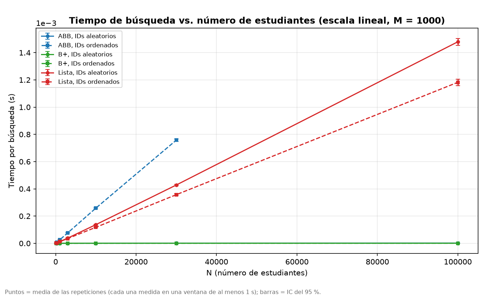
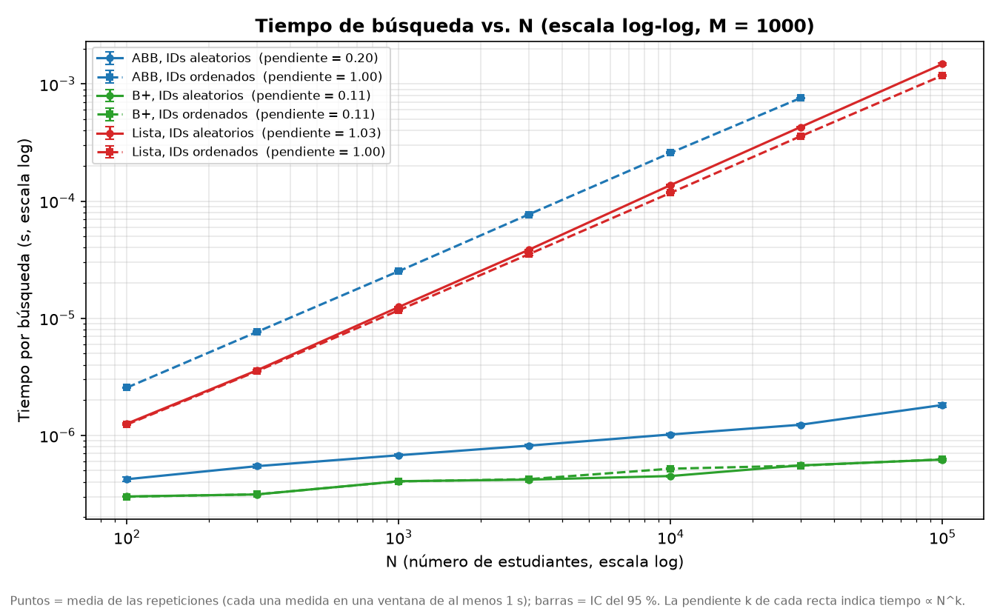
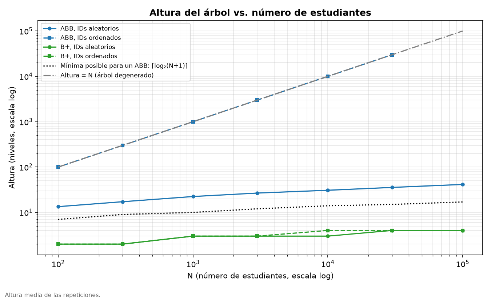
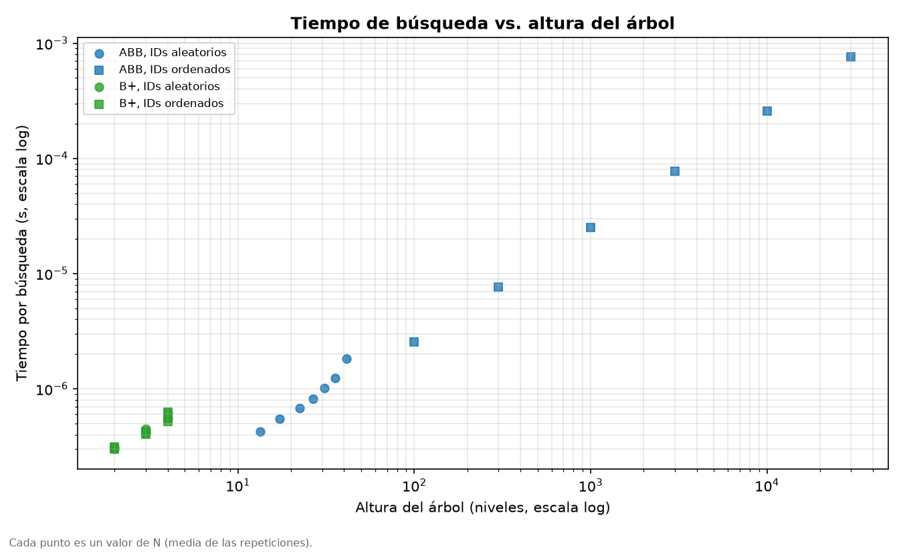
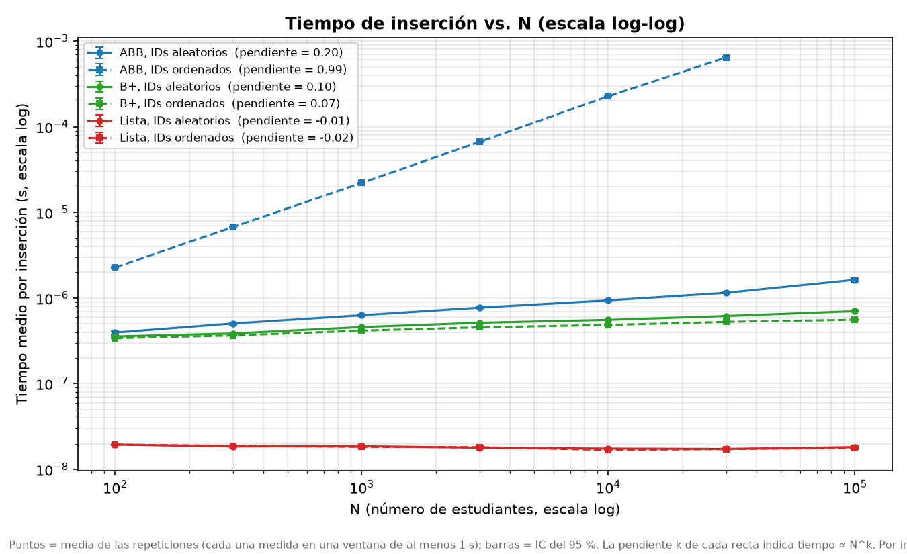
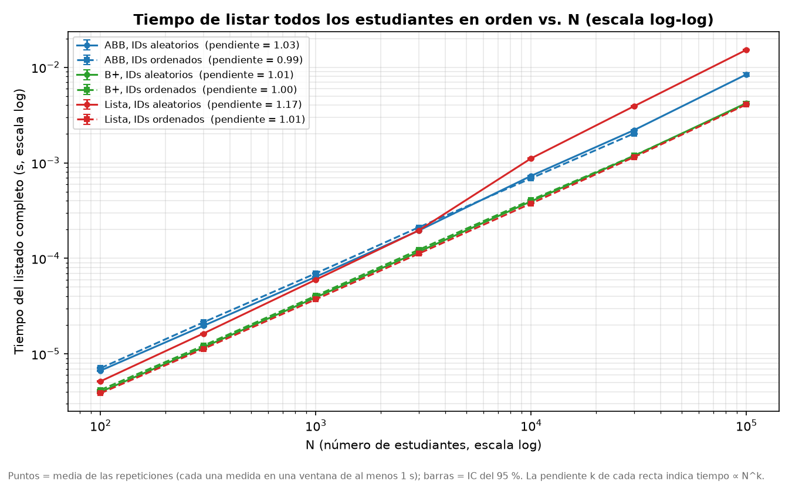
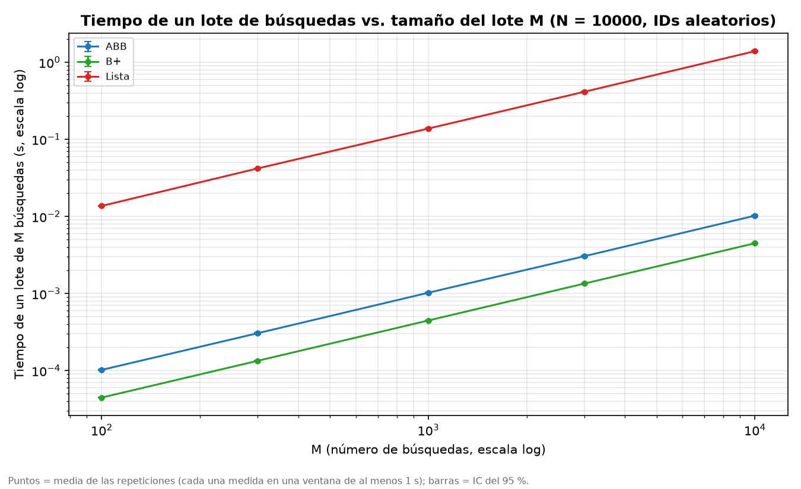

# Laboratorio 3 — Sistema de búsqueda de estudiantes: Lista vs ABB vs Árbol B+

**Integrantes:** <Santiago Acevedo Correa - 1018235032>

---

## 1. Problema y objetivo

Una institución necesita un sistema que permita **buscar** un estudiante por ID,
**insertar** estudiantes y **listar** todos los estudiantes en orden de ID. Cada estudiante tiene
ID (matrícula), nombre, edad y promedio.

**Objetivo:** estudiar experimentalmente cómo el tiempo de esas tres operaciones **escala al
aumentar el número de estudiantes N** en tres estructuras de datos (lista, árbol binario de
búsqueda y árbol B+), con dos órdenes de inserción (IDs ordenados y aleatorios), y comparar los
resultados con la complejidad teórica usando análisis estadístico. También nos interesa
identificar **dónde la realidad se aparta de la teoría** y por qué.

## 2. Contenido del repositorio

| Archivo | Qué contiene |
|---|---|
| `lista.py` | Generación de estudiantes (`generar_estudiantes(cantidad, orden, semilla)`) y sistema con lista. |
| `ABB.py` | Árbol binario de búsqueda (inserción, búsqueda, recorrido inorden y altura, todos iterativos). |
| `arbolbplus.py` | Árbol B+ (inserción con división de nodos, búsqueda, eliminación, recorrido por hojas enlazadas). |
| `implementacion.py` | Menú interactivo del sistema usando el árbol B+. |
| `experimento.py` | Corre los experimentos y guarda cada medición en `resultados/mediciones.csv`. |
| `analisis.py` | Calcula las estadísticas y genera `resultados/resumen.md`. |
| `graficas.py` | Genera las gráficas en `graficas/` a partir de los resultados guardados. |
| `resultados/` | Mediciones crudas, estadísticas, pendientes, resumen y descripción del entorno. |
| `graficas/` | Las gráficas generadas (en este informe se usan de la 1 a la 7). |
| `CODIGO_DE_HONOR.md` | Código de honor y declaración de uso de IA. |

## 3. Cómo reproducir los experimentos

```bash
pip install -r requirements.txt          # en Windows: py -m pip install -r requirements.txt

python experimento.py --rapido   # prueba de ~1 minuto (se guarda en resultados_prueba/)
python experimento.py            # experimento completo (~1 hora)
python analisis.py               # estadísticas -> resultados/resumen.md
python graficas.py               # gráficas -> graficas/
```

Las gráficas y estadísticas se pueden regenerar sin repetir el experimento, porque
`analisis.py` y `graficas.py` solo leen `resultados/mediciones.csv`.

Para probar el sistema interactivo: `python implementacion.py`.

## 4. Metodología

### 4.1 Estructuras y complejidad teórica

| Estructura | Insertar (uno) | Buscar | Listar en orden | Altura |
|---|---|---|---|---|
| Lista | O(1) (`append`) | O(N) | O(N log N) (ordenar); O(N) si ya está ordenada | — |
| ABB, IDs aleatorios | O(log N) promedio | O(log N) promedio | O(N) (inorden) | ≈ c·log N |
| ABB, IDs ordenados | O(N) | O(N) | O(N) | N (degenerado) |
| Árbol B+ (orden 32) | O(log N) | O(log N) | O(N) (hojas enlazadas) | ≈ log₃₂ N |

### 4.2 Hardware y software

Ver `resultados/entorno.txt` (lo genera `experimento.py` automáticamente).

- **Procesador:** AMD Ryzen 9 8940HX with Radeon Graphics, 2401 MHz, 16 núcleos, 32 procesadores lógicos.
- **RAM:** 16 GB
- **Sistema operativo:** Windows 11 (10.0.26200)
- **Python:** 3.14.7 (CPython); librerías: numpy, pandas, scipy, matplotlib.
- **Reloj:** `time.perf_counter()`, que en Windows usa `QueryPerformanceCounter`, con resolución de 100 ns (10⁻⁷ s).
- **Condiciones:** portátil conectado a la energía, modo Turbo, sin otros programas abiertos durante
  la ejecución, sincronización en la nube desactivada.

### 4.3 Parámetros

| Parámetro | Valores | Justificación |
|---|---|---|
| N (estudiantes), experimento A | 100, 300, 1 000, 3 000, 10 000, 30 000, 100 000 | Crecen ~×3: quedan espaciados de forma pareja en escala log y cubren desde N pequeño (dominan costos constantes) hasta N grande (domina la complejidad). |
| M (búsquedas por lote), experimento A | 1 000 | Se buscan lotes de 1 000 IDs; se reporta el tiempo **por búsqueda**. |
| M, experimento B | 100, 300, 1 000, 3 000, 10 000 con N = 10 000 | Estudiar M como parámetro. |
| Orden de inserción | ordenado, aleatorio | Sugerencia del enunciado; afecta mucho al ABB. |
| Repeticiones | 20 por combinación | Cada medición ya promedia miles de operaciones durante ≥ 1 s, así que su ruido propio es bajo; 20 repeticiones con datos distintos dan intervalos de confianza estrechos y mantienen la duración total en ~1 hora. |
| Ventana mínima de medición | 1 segundo | Guías de benchmarking (ver 4.7). |
| Orden del árbol B+ | 32 (hasta 31 claves por nodo) | Valor intermedio típico. |
| Límite del ABB ordenado | N ≤ 30 000 | Construirlo es O(N²): una sola construcción con N = 100 000 tardaría ~3.5 minutos (ver 4.7). |

### 4.4 Generación de los datos

`generar_estudiantes(cantidad, orden, semilla)` crea los IDs 1..N. En el caso **aleatorio** son
**los mismos IDs revueltos** (una permutación). Así, entre ambos casos solo cambia el orden de
inserción. Nombre (de una lista fija de 30), edad (16–30) y promedio (0–10) se generan al azar.
La semilla de cada repetición es su número, lo que hace el experimento reproducible.

### 4.5 Generación de las búsquedas

Las búsquedas se hacen en **lotes de M IDs** elegidos al azar entre 1 y N **con reemplazo**
(permite M > N). Cada lote usa **IDs nuevos**, generados antes de empezar a cronometrar. Con la
misma semilla, **las tres estructuras buscan exactamente la misma secuencia de IDs**. Todos los IDs
buscados existen.

### 4.6 Medición de tiempos

- Reloj: `time.perf_counter()`. El recolector de basura de Python se desactiva durante cada medición.
- **Cada medición dura al menos 1 segundo.** La operación (construir la estructura, un lote de
  búsquedas o un listado) se ejecuta una vez para calibrar cuánto tarda; esa ejecución se
  descarta (sirve de calentamiento), salvo que ya dure 1 s o más. Luego se repite las veces
  necesarias para llenar la ventana, y se divide el tiempo total por el número de repeticiones.
  - Construir: cada repetición construye la estructura desde cero.
  - Buscar: cada repetición es un lote con IDs nuevos, para no reutilizar siempre los mismos
    caminos del árbol (quedarían en la caché del procesador y el tiempo saldría optimista).
  - Listar: cada repetición genera el listado completo de nuevo.
- **Orden aleatorio de las configuraciones:** en cada repetición, las 14 combinaciones
  (N, orden de inserción) se recorren en orden aleatorio, y también el orden de las tres
  estructuras. Así, un cambio de velocidad del computador afecta a todos los N por igual y no se
  confunde con el efecto de N (ver sección 5).
- Cada medición guarda su momento (minutos desde el inicio) y la duración real de su ventana.
- Comprobación de correctitud: se encuentran todos los IDs buscados y el listado sale
  1, 2, ..., N. Si no, el experimento se detiene.

### 4.7 Duración de las mediciones y guías de benchmarking

**Por qué los resultados están en nanosegundos o microsegundos.** La pregunta del laboratorio es
cómo crece el costo de **una** operación (una búsqueda, una inserción) con N, porque eso es lo que
predice la complejidad teórica (O(N), O(log N)). Una búsqueda en un árbol B+ cuesta menos de un
microsegundo, así que el resultado **reportado** es naturalmente pequeño. En las tablas se usa µs
(1 µs = 10⁻⁶ s) para no escribir muchos ceros, y en las gráficas segundos con notación científica.
Reportar el tiempo total no serviría: mezclaría el efecto de N con el número de operaciones.

**Por qué cada medición dura al menos 1 segundo.** Las guías de benchmarking recomiendan que lo
que se cronometra dure entre 1 segundo y 5 minutos. Si dura muy poco, cualquier interrupción del
sistema operativo (cambio de proceso, interrupciones de hardware, actualizaciones en segundo
plano) pesa mucho en relación con lo medido: una sola búsqueda en el B+ (~0.3 µs) dura apenas
3 veces la resolución del reloj. Por eso el experimento mide **siempre** ventanas de al menos 1 s
y reporta el costo por operación como total / repeticiones. Se cumplió en el 100 % de las
2 760 mediciones:

| Operación | Mediciones | Ventana mínima | Ventana mediana | Ventana máxima |
|---|---|---|---|---|
| Construir (insertar N) | 820 | 1.000 s | 1.022 s | 19.8 s |
| Buscar | 820 | 1.000 s | 1.005 s | 1.6 s |
| Listar | 820 | 1.000 s | 1.014 s | 1.1 s |
| Buscar (experimento B) | 300 | 1.000 s | 1.005 s | 1.5 s |

Con una resolución del reloj de 100 ns, el error por resolución en una ventana de 1 s es de una
parte en diez millones.

**El límite superior de 5 minutos.** La medición más larga es construir el ABB degenerado con
N = 30 000 (~19 s). Construirlo con N = 100 000 costaría unas (100 000 / 30 000)² ≈ 11 veces más,
unos 3.5 minutos por medición; con 20 repeticiones serían más de 70 minutos solo para ese caso.
Por eso se mide solo hasta N = 30 000. El experimento completo (~58 minutos) no es "una
aplicación" cronometrada: son 2 760 mediciones independientes, cada una entre 1 s y ~19 s.

**Costo de esta decisión.** Repetir una operación muchas veces puede dejar datos en la caché del
procesador y dar tiempos algo optimistas. Lo mitigamos con IDs nuevos en cada lote de búsquedas y
construyendo cada estructura desde cero, pero con N pequeño todos los datos caben en la caché de
todas formas (lo mismo pasaría en un programa real).

### 4.8 Estadísticas y tratamiento de atípicos

Para cada combinación (operación, estructura, orden, N) sobre las repeticiones: media,
desviación estándar muestral, coeficiente de variación (CV), mediana, mínimo, máximo e
**intervalo de confianza del 95 %** con la distribución t de Student.

**Atípicos:** regla 1.5·IQR (por fuera de [Q1 − 1.5·IQR, Q3 + 1.5·IQR]). No se eliminan: se
reporta cuántos hubo y la media sin ellos, para comprobar que no cambian las conclusiones.

**Comparación con la teoría:**
- Regresión lineal de log(tiempo medio) contra log(N): la pendiente k estima el exponente en
  tiempo ∝ N^k (k ≈ 1 → O(N); k ≈ 0 → O(log N) u O(1)), con su R².
- En los árboles, además, la pendiente de log(altura) contra log(N). Si cada nivel costara
  siempre lo mismo, ambas pendientes serían iguales.
- Correlación de Pearson entre la altura del árbol y el tiempo por búsqueda.
- Dos estructuras difieren claramente cuando sus IC95 no se superponen.

Como referencia: en el rango N = 100 a 100 000, una curva exactamente proporcional a log₂ N tiene
pendiente log-log **0.131**, y una proporcional a N·log₂ N tiene pendiente **1.131**.

Todas las tablas están en `resultados/resumen.md`.

## 5. Calidad de las mediciones

Antes de interpretar los resultados se comprobó que las mediciones son confiables:

| Indicador | Valor |
|---|---|
| CV mediano, búsqueda | 2.9 % |
| CV mediano, inserción | 3.9 % |
| CV mediano, listado | 3.0 % |
| CV máximo (cualquier operación) | 11.7 % (inserción en ABB aleatorio, N = 100 000) |
| CV máximo, experimento B | 4.9 % |
| Cambio máximo de una media al quitar atípicos | 3.7 % |
| Mediana del tiempo relativo en los 4 cuartos del experimento | 1.000, 1.001, 1.000, 0.998 |

- **Ruido bajo:** en casi todas las combinaciones las 20 repeticiones difieren menos de un 5 %, y
  los atípicos no cambian ninguna conclusión. Los casos más ruidosos se discuten en la sección 8,
  punto 8.
- **Computador estable:** al dividir cada medición por la mediana de su grupo, el tiempo relativo
  se mantuvo en 1.000 ± 0.002 durante todo el experimento (`resultados/resumen.md`). Como además las
  configuraciones se midieron en orden aleatorio (sección 4.6), un cambio de velocidad del
  portátil no podría confundirse con el efecto de N.

## 6. Resultados

Las tablas completas (media, desviación, CV, IC95, mediana, atípicos) están en `resultados/resumen.md`.
En las gráficas el tiempo está en segundos; en el texto se usa µs (1 µs = 10⁻⁶ s).

**Condiciones de la medición.** El experimento duró 57.9 minutos. La mediana del tiempo relativo
fue 1.000, 1.001, 1.000 y 0.998 en los cuatro cuartos del experimento A: el computador mantuvo la
misma velocidad (ver sección 8, punto 9).

### Búsqueda

*Tiempo medio por búsqueda contra N en escala lineal. La lista y el ABB ordenado crecen en línea
recta; el ABB aleatorio y el B+ quedan pegados al eje.*


*Misma información en escala log-log; en la leyenda, la pendiente k de cada curva.*

| Búsqueda (µs) | N = 100 | N = 1 000 | N = 10 000 | N = 30 000 | N = 100 000 | Pendiente k |
|---|---|---|---|---|---|---|
| Lista (ordenado) | 1.24 | 11.7 | 117.7 | 357.2 | 1 182 | 0.997 |
| Lista (aleatorio) | 1.26 | 12.5 | 137.2 | 428.3 | 1 480 | 1.029 |
| ABB (ordenado) | 2.56 | 25.2 | 258.6 | 757.8 | — | 1.000 |
| ABB (aleatorio) | 0.42 | 0.68 | 1.02 | 1.23 | 1.82 | 0.199 |
| B+ (ordenado) | 0.30 | 0.40 | 0.52 | 0.55 | 0.62 | 0.111 |
| B+ (aleatorio) | 0.30 | 0.41 | 0.45 | 0.55 | 0.62 | 0.106 |

### Altura

*Altura media del árbol. El ABB ordenado coincide con la recta altura = N. El ABB aleatorio va de
13.4 niveles (N = 100) a 41.4 (N = 100 000), entre 2.0 y 2.5 veces el mínimo posible log₂(N+1).
El B+ tiene entre 2 y 4 niveles.*


*Cada punto es un N. Correlación de Pearson altura–tiempo: r = 1.000 en el ABB y r = 0.961 en el
B+ (p < 0.001 en ambos).*

### Inserción y listado

*Tiempo medio por inserción (tiempo de construcción / N). Pendientes: ABB ordenado 0.993, ABB
aleatorio 0.195, B+ 0.099 (aleatorio) y 0.074 (ordenado), lista −0.012 y −0.016.*


*Tiempo de obtener todos los estudiantes ordenados por ID. Pendientes: lista aleatoria 1.174,
ABB aleatorio 1.032, B+ aleatorio 1.006, lista ordenada 1.006, B+ ordenado 0.997, ABB ordenado
0.991.*

### Efecto de M

*Tiempo de un lote de M búsquedas con N = 10 000. Pendientes: lista 1.002, B+ 1.001, ABB 1.000
(R² = 1.000 en las tres).*


## 7. Interpretación

**¿Los resultados se comportan como predice la complejidad teórica?**
En las tendencias, sí, y con bastante precisión:
- La lista y el ABB ordenado tienen pendientes de 0.997 a 1.029 con R² ≥ 0.9999: O(N) casi de libro.
- El B+ tiene pendientes de 0.106 y 0.111, un poco por debajo de 0.131 (log₂ N), pero casi
  iguales a las de su propia altura (0.108 y 0.117). Su tiempo crece como su número de niveles,
  que es O(log N); la pendiente queda algo menor porque parte del costo de cada búsqueda (llamar
  la función, preparar la búsqueda) es fijo y no depende de N.
- El ABB aleatorio tiene pendiente 0.199, mayor que 0.131 y que la de su propia altura (0.160): es
  O(log N) en número de pasos, pero cada paso se encarece al crecer N (sección 8, punto 3).
- Listar: la lista revuelta tiene pendiente 1.174, cerca de lo que predice O(N log N) en este rango
  (1.131); las demás están entre 0.991 y 1.032, como predice O(N).
- Insertar en la lista cuesta lo mismo con cualquier N (~0.018 µs, pendiente ≈ 0): O(1).

**¿En qué situaciones el ABB deja de comportarse como O(log N)? ¿Qué ocurre con datos ordenados?**
Cuando se inserta en orden. Cada ID nuevo es mayor que todos los anteriores, siempre va a la
derecha, y el árbol se vuelve una fila india: altura = N exactamente, en todas las repeticiones.
Buscar pasa a ser O(N) (pendiente 1.000) y construirlo O(N²): cada inserción cuesta O(N) (pendiente
0.993 *por inserción*). Con N = 30 000, construir el ABB ordenado tomó 19.3 s; construir el B+ con
100 000 estudiantes, 0.06–0.07 s.

**¿Qué relación existe entre la altura del árbol y el tiempo de búsqueda?**
Una búsqueda visita un nodo por nivel, así que el tiempo ≈ (costo por nivel) × (altura). En el
ABB la correlación es r = 1.000, en gran parte porque el ABB ordenado cubre alturas de 100 a 30 000.
En el ABB ordenado el costo por nivel de altura es asombrosamente constante (25.2 a 25.9 ns con
todos los N). En el ABB aleatorio es casi constante (30 a 35 ns) hasta N = 30 000 y luego sube a
44 ns con N = 100 000. En el B+ la correlación también es alta (r = 0.961): su altura solo toma los
valores 2, 3 y 4, y dentro de cada nodo hay una búsqueda entre hasta 31 claves, por lo que cada
nivel cuesta más (~130 a 157 ns).

**¿Qué diferencias aparecen entre los casos aleatorio y ordenado?**
- **ABB:** enorme. Con N = 30 000, 758 µs por búsqueda con datos ordenados contra 1.23 µs con datos
  aleatorios: unas 615 veces más.
- **B+:** pequeña pero real (sección 8, punto 4): con N = 10 000 el B+ ordenado tiene un nivel más y
  tarda 15.5 % más al buscar, pero inserta entre 4.5 % y 20.6 % más rápido con todos los N.
- **Lista:** en teoría ninguna en búsqueda, pero la lista aleatoria fue entre 6.6 % y 25.1 % más
  lenta desde N = 1 000, con intervalos de confianza separados (sección 8, punto 2). Al listar, la
  lista revuelta es hasta 3.7 veces más lenta, como se espera: ordenarla es O(N log N), y ordenar
  una lista ya ordenada es O(N).

**¿A partir de qué tamaño son claramente visibles las diferencias?**
Con IDs aleatorios, los árboles ya son más rápidos que la lista con N = 100 (IC95 separados): el
B+ unas 4.2 veces y el ABB unas 3. La diferencia crece con N: con N = 100 000 el B+ es ~2 400 veces
más rápido que la lista y el ABB aleatorio ~810 veces. En la gráfica lineal la separación se ve a
simple vista desde N ≈ 10 000; en la log-log, desde el primer punto.

**¿Existen costos constantes que hagan parecidos algoritmos de distinta complejidad con N pequeño?**
Sí:
- Con N = 100, el ABB aleatorio (0.42 µs) y el B+ (0.30 µs) están cerca, aunque el ABB tiene 13
  niveles y el B+ solo 2: bajar un nivel del B+ cuesta ~150 ns, contra ~31 ns en el ABB.
- El ABB ordenado y la lista tienen la misma complejidad, O(N), pero el ABB es ~2.1 veces más lento
  con todos los N (sección 8, punto 1).
- Con N = 100 la lista (O(N)) es solo ~4 veces más lenta que el B+ (O(log N)); con N = 100 000,
  ~2 400 veces.

**Efecto de M:** el tiempo de un lote crece exactamente proporcional a M (pendientes 1.000 a 1.002).

## 8. Resultados inesperados

Las tendencias siguen la teoría, pero aparecieron varias desviaciones. Las que tienen una
explicación probable pero no verificada se presentan como **hipótesis**.

**1. El ABB degenerado es el doble de lento que la lista, con la misma complejidad.**
El ABB ordenado es entre 2.07 y 2.20 veces más lento que la lista ordenada en todos los N, con IC95
separados. Ambos recorren en promedio N/2 elementos, pero cada paso cuesta distinto: ~24 ns por
elemento en la lista contra ~51 ns por nodo en el ABB (25.5 ns por nivel de altura, y en promedio
se recorre la mitad de la altura). *Hipótesis:* el `for` sobre una lista avanza sobre un arreglo
contiguo de referencias, mientras que en el ABB cada paso lee `nodo.estudiante`, luego `["id"]`,
compara y luego lee `nodo.derecha`: más instrucciones del intérprete y saltos a objetos dispersos
en memoria.

**2. La lista con IDs aleatorios es más lenta que con IDs ordenados, aunque compara lo mismo.**
Ambas listas contienen los mismos IDs y una búsqueda hace en promedio el mismo número de
comparaciones. Con N = 100 y 300 la diferencia es de 1.8 % y no es significativa, pero desde
N = 1 000 crece de forma sostenida: 6.6 %, 9.1 %, 16.5 %, 19.9 % y 25.1 % con N = 100 000, siempre
con IC95 separados. *Hipótesis:* en `generar_estudiantes` los números de ID (objetos `int` de
Python) se crean en orden 1..N y después se revuelven. En la lista ordenada, recorrerla visita esos
`int` en el mismo orden en que están en memoria; en la aleatoria salta entre posiciones dispersas.
Con N pequeño todo cabe en la caché y no se nota; con N grande, sí.

**3. El ABB aleatorio crece más rápido que su altura.**
Su tiempo de búsqueda tiene pendiente 0.199, pero su altura solo 0.160. El costo por nivel es
estable (30–35 ns) hasta N = 30 000 y salta a 44 ns con N = 100 000. *Hipótesis:* con 100 000
nodos (cada uno con su diccionario) el árbol ya no cabe en los niveles más rápidos de la caché, y
como los nodos se crearon en orden aleatorio, cada paso de la búsqueda salta a una zona distinta
de memoria. El B+ no muestra este efecto (punto 7) porque visita solo 2 a 4 nodos.

**4. El B+ no es completamente indiferente al orden de inserción.**
- *Búsqueda:* solo hay diferencia significativa con N = 10 000, donde el B+ ordenado tiene 4 niveles
  y el aleatorio 3, y tarda 15.5 % más. En los demás N ambos tienen la misma altura y la diferencia
  es menor al 1 % (IC95 superpuestos).
- *Inserción:* el ordenado es más rápido con todos los N (4.5 % con N = 100, 20.6 % con
  N = 100 000), con IC95 separados.

*Hipótesis:* al dividir un nodo lleno, `arbolbplus.py` deja la mitad de las claves en cada lado. Con
IDs ordenados nunca se vuelve a insertar en la mitad izquierda, así que los nodos quedan llenos al
~50 % en vez de ~70 % con IDs aleatorios: hay más nodos y a veces un nivel más (con N = 10 000:
~625 hojas contra ~455, que necesitan 4 y 3 niveles). A cambio, insertar siempre en la hoja de más
a la derecha reutiliza el mismo camino (que queda en caché) y agrega la clave al final de la hoja,
sin desplazar las demás.

**5. Un patrón común: recorrer los datos en el mismo orden en que se crearon es más rápido.**
Los puntos 2 y 4 (inserción) tienen algo en común: el caso "ordenado" accede a la memoria en el
mismo orden en que se crearon los objetos. Lo mismo se ve al listar el ABB con N grande: con
N = 10 000 y 30 000 el ABB ordenado lista 6 % y 8 % más rápido que el aleatorio, aunque ambos son
O(N). Es una explicación unificadora plausible, pero **no se midió la caché**, así que sigue siendo
una hipótesis.

**6. La altura del ABB aleatorio coincide con la teoría probabilística.**
La altura esperada de un ABB construido con un orden aleatorio es ≈ 4.311·ln N − 1.953·ln ln N + O(1)
(Reed, 2003). Con nuestros N esos dos términos dan 16.9, 21.2, 26.0, 30.5, 35.4, 39.9 y 44.9
niveles; los medidos fueron 13.4, 17.2, 22.4, 26.7, 30.8, 35.6 y 41.4. La diferencia es casi
constante (3.5 a 4.6 niveles), como corresponde al término O(1). Por eso la altura queda entre 2.0
y 2.5 veces el mínimo log₂(N+1), y esa razón crece lentamente con N.

**7. El tiempo del B+ sigue a la altura, que crece "a saltos".**
La altura del B+ solo cambia de 2 a 3 niveles (entre N = 300 y 1 000) y de 3 a 4 (entre 10 000 y
30 000 en el aleatorio). En esos saltos el tiempo de búsqueda sube 30 % y 23 %; entre ellos, con la
misma altura, sube mucho menos (de 0.406 a 0.450 µs entre N = 1 000 y 10 000). Por eso su pendiente
(0.106 / 0.111) coincide con la de su altura (0.108 / 0.117), y el costo por nivel se mantiene entre
130 y 157 ns con todos los N.

**8. Con N = 100 000 queda ruido aunque las ventanas sean largas.**
Casi todas las combinaciones tienen CV por debajo del 5 %, pero con N = 100 000 el ABB aleatorio
llega a 9.3 % (búsqueda), 11.7 % (inserción) y 9.3 % (listado), y el B+ aleatorio a 6.7 % al
listar. Aun así, quitar los atípicos cambia las medias como máximo un 3.7 %.
*Hipótesis:* es el caso que más depende de la memoria (punto 3), así que es el más sensible a lo
que haya en la caché en cada momento; además, repetir las búsquedas para llenar la ventana de 1 s
favorece que partes del árbol queden en caché.

**9. Una correlación "significativa" que no importa.**
Para el control de estabilidad, la correlación de Spearman entre el momento de la medición y el
tiempo relativo fue ρ = −0.074 con p = 0.035: estadísticamente significativa al 5 %. Pero el efecto
es despreciable: las medianas de los cuatro cuartos del experimento fueron 1.000, 1.001, 1.000 y
0.998, es decir, una variación de 0.2 %. Con 820 mediciones, hasta una tendencia mínima da un
p-valor pequeño.


## 9. Hallazgos principales

1. La búsqueda en lista escala linealmente (k = 1.00 a 1.03, R² ≈ 1), como predice la teoría.
2. El B+ escala como O(log N) (su tiempo sigue exactamente a su altura: k = 0.11 frente a 0.11–0.12),
   es el más rápido con todos los N (~2 400 veces más que la lista con N = 100 000) y casi no
   depende del orden de inserción.
3. El ABB solo es O(log N) si los datos llegan desordenados. Con datos ordenados degenera
   (altura = N) y es incluso más lento que la lista: misma complejidad, el doble de costo por paso.
4. El tiempo de búsqueda en los árboles está determinado por la altura (r = 1.000 en el ABB, 0.961
   en el B+), pero el costo de cada nivel aumenta cuando la estructura ya no cabe en la caché, y
   depende del orden en que se crearon los datos.
5. La complejidad predice bien las tendencias, pero no los tiempos exactos: los costos constantes,
   la memoria y la forma de medir importan. Medir ventanas de al menos 1 s, como recomiendan las
   guías de benchmarking, dio mediciones con CV mediano por debajo del 4 %.

## 10. Limitaciones y qué no se puede concluir

- Se midió en Python: los tiempos incluyen el costo del intérprete. Las **tendencias** son
  válidas; los valores absolutos no se trasladan a otro lenguaje, otra versión de Python ni otro
  computador.
- Un solo computador (portátil); el ruido se trató con repeticiones, ventanas de 1 s, orden aleatorio,
  análisis de atípicos y control de estabilidad.
- El ABB ordenado se midió solo hasta N = 30 000.
- Solo se buscaron IDs existentes (buscar un ID inexistente sería el peor caso de la lista).
- Un solo orden para el B+ (32).
- No se midió el uso de memoria ni el uso de la caché: las explicaciones basadas en la caché
  (sección 8) son hipótesis consistentes con los datos, no mediciones.
- Repetir operaciones para llenar la ventana de 1 s favorece la caché en estructuras grandes
  (sección 8, punto 8): los tiempos representan un uso intensivo y continuo.
- Un p-valor pequeño no implica un efecto importante (sección 8, punto 9).

## 11. Uso de inteligencia artificial

Ver `CODIGO_DE_HONOR.md`.
